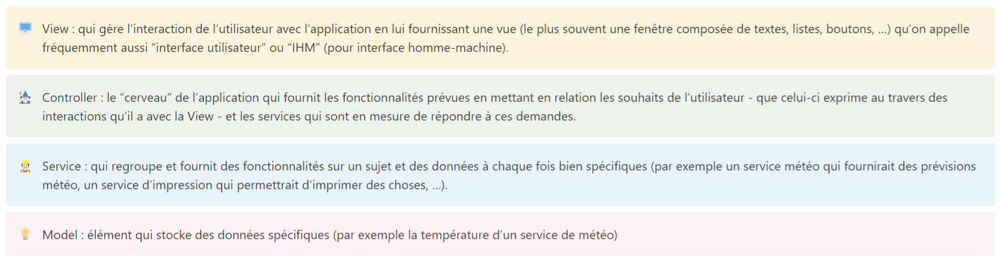
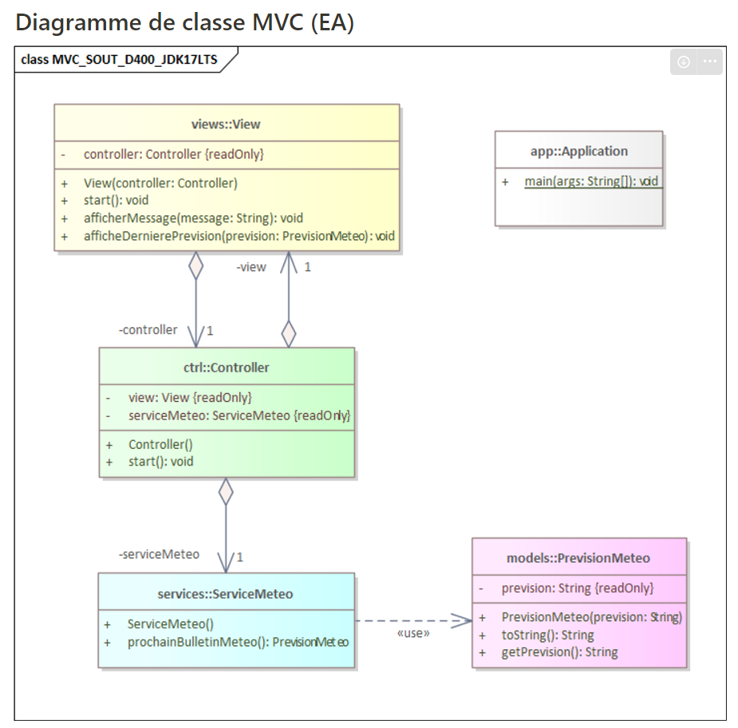
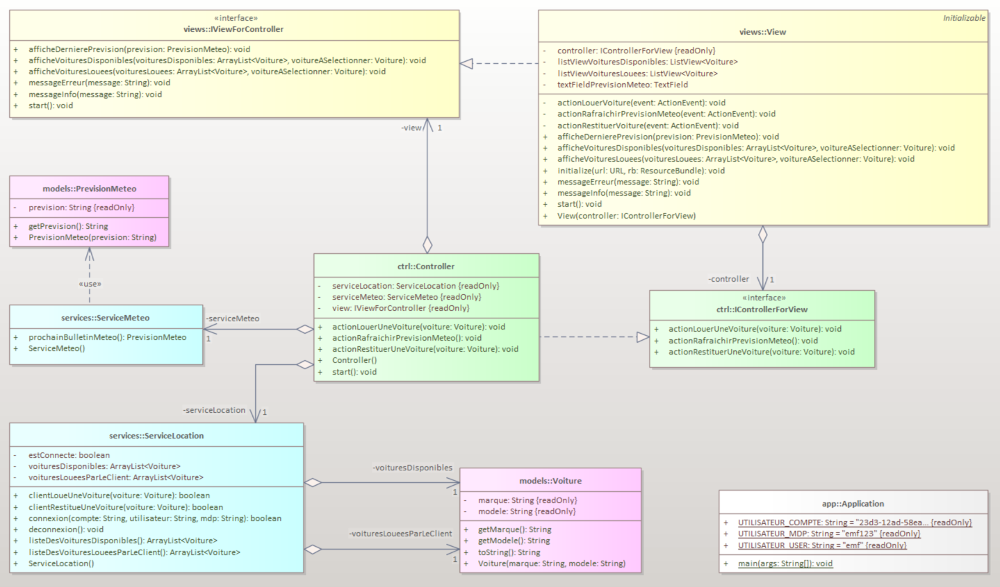

# Pattern MVC

Vous avez déjà étudié ce pattern au module D400. Mais nous allons reprendre le sujet afin que:

- Vous compreniez quels sont les principes POO qui y sont appliqués.
- Vous connaissiez les différentes formes MVC

## Pattern MVC sans utilisation d'interfaces (comme au D400)




### Analyse des principes POO appliqués par ce pattern

#### Responsabilité unique

La construction de ce pattern en séparant le travail de la vue, du controlleur, du serviceMétéo dans leurs classes rejoint le principe de la responsabilité unique : chaque classe a sa responsabilité clairement définie.

#### Encapsulation

Tous les attributs avec une visibilité privée respectent le principe d'encapsulation. Il ne peuvent être accédés que par les méthodes prévues dans leur propre classe.

D'une manière plus générale, la construction de ce pattern, en séparant le travail de la vue, du controlleur, du serviceMétéo dans des classes respectives, rejoint le principe d'encapsulation.

#### Abstraction

Les méthodes publiques d'un objet que l'on peut appeler ne donnent pas de détail sur le fonctionnement. C'est de l'abstraction. Par exemple, en utilisant la méthode afficherDernièrePrevision nous avons l'assurance qu'elle affichera bien la prévision météo mais sans aucune idée du comment elle procédera pour le faire.

#### Héritage et polymorphisme

Ce pattern n'utilise aucun de ces principes.

#### Couplage


Comme ce schéma UML le montre bien :

- La classe `Controller` possède un attribut `view` de type `View` afin pouvoir lui demander d'afficher des choses.
- La classe `View` possède un attribut `controller` de type `Controller` afin de pouvoir communiquer avec son contrôleur, par exemple pour lui dire que l'utilisateur souhaite telle ou telle action (bouton).

 On observe un couplage fort entre ces deux classe car elles sont interdépendantes. En effet, dans l'implémentation, chaque classe devra connaître le type de l'autre classe (import) et chaque modification de signatures des méthodes aura un impact sur l'autre classe.

#### La réutilisabilité

Les classes `ServiceMeteo` et `PrevisionMeteo` rejoignent ce principe : elles pourraient être réutilisées sans modification par une autre application.

## Pattern MVC avec utilisation d'interfaces

Ce Pattern poursuit les mêmes objectifs que le précédent, mais ajoute une couche de flexibilité.

Grâce à l'utilisation d'interfaces, les trois composants controlleur/vue/services deviennent davantage indépendants les uns des autres. Leur dépendance n'est plus une dépendance par nature (lié à une classe spécifique) mais par fonctionnalité (lié à une interface).

On pourra plus facilement remplacer certaines briques du logiciel, voire même fournir plusieurs versions de celles-ci (skinning).

Voici le diagramme UML complet de ce MVC avec interfaces :



### Analyse des principes POO appliqués par ce pattern

Ce pattern reprend tous les principes du précédent mais apporte une amélioration concernant le couplage.

#### Couplage

**Comment la vue accède aux méthodes du controller ?**

On voit ici la présence de l'interface `IControllerForView` :

- La classe `Controller` implémente cette interface, c'est à dire qu'elle s'engage à fournir une implémentation pour toutes les méthodes de cette interface, de ce savoir-faire `IControllerForView`.
- De son côté la classe `View` possède une référence à un savoir-faire `IControllerForView`. Elle pourra donc appeler les méthodes déclarées dans cette interface `IControllerForView`, mais rien d'autre, car elle ne saura rien de la nature de l'objet "au bout du fil". Elle ignore tout de la classe `Controller` car elle ne connait pas son type. Elle n'a pas besoin d'effectuer un import sur cette classe.

Ces explications nous font comprendre que le couplage entre la classe `View` et `Controller` est faible. En effet aucune ne "connait" ou ne "fait appel" directement à l'autre.

Ces classes sont désormais **liées par savoir-faire** et non plus liées par nature.

#### Polymorphisme

Implémentation de l'interface `IViewForController` pour la `View` :

```java
public class View implements IViewForController, Initializable {

    ...
    public View(IControllerForView controller) { //Point clé: référence de type IControllerForView
        this.controller = controller;
    }
    ...
```

Implémentation de l'interface `IControllerForView` pour le `Controller` :

```java
public class Controller implements IControllerForView {

    ...
    public Controller() {
        view = new View(this);  //Point clé: passage d'une référence de type Controller
        serviceMeteo = new ServiceMeteo();
        serviceLocation = new ServiceLocation();
    }
    ...
```

Cette implémentation illustre le principe de **liaison dynamique tardive**.

En effet, à l'execution du code, lors du passage en paramètre de la référence `this` du `Controller` au constructeur de la `View`, java utilise la **liaison dynamique** pour déterminer le type de la référence. En effet, dans notre cas un `Controller` est bien aussi un `IControllerForView` puisqu'il implémente cette interface ! En clair, dans notre cas un objet `Controller` saura réaliser l'ensemble du savoir-faire décrit dans `IControllerForView` puisqu'il déclare implémenter cette interface. Et c'est ainsi qu'un `IControllerForView` sera transmis à la `View`.

L'implémentation d'interface avec liaison tardive sont des outils puissants pour limiter le couplage et appliquer le polymorphisme.

Cela permettrait, par exemple, de complètement modifier la classe `Controller` sans aucun heurts pour le reste de l'application (du moment qu'elle continue à implémenter l'interface `IControllerForView`, personne n'en saura rien).

## Ressources

- [Pattern MVC EMF: Théorie](https://ram-emf.notion.site/D-veloppement-f2f75560def446ff9383896c8ac16416)
- [Pattern MVC JFX avec interfaces : Projet Github](https://github.com/emf-info/MVC_FXML_226A_JDK17LTS)
