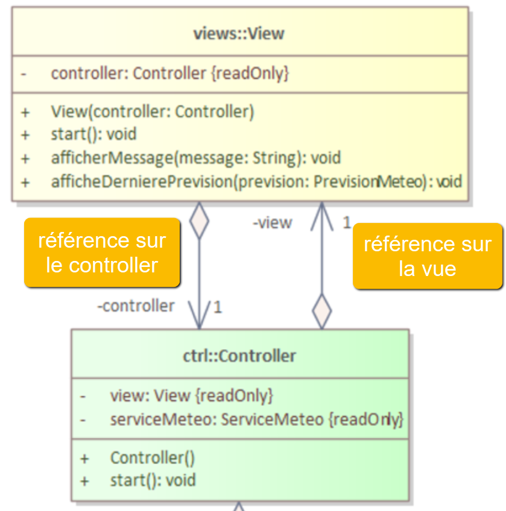

# Pattern MVC

Vous avez déjà étudié ce pattern au module D400. Mais nous allons reprendre le sujet afin que:

- Vous compreniez quels principes POO vus précédement sont appliqués.
- Vous connaissiez les différentes formes MVC


## MVC vu au D400


### Analyse des principes POO appliqués par ce pattern:

#### Responsabilité unique
La construction de ce pattern en séparant le travail de la vue, du controlleur, du serviceMétéo dans leurs classes rejoint le principe de la responsabilité unique.

#### Encapsulation
Tous les attributs avec une visibilité privée respectent le principe d'encapsulation. Il ne peuvent être accédés que par les méthodes de leur propre classe.
D'une manière plus générale, la construction de ce pattern, en séparant le travail de la vue, du controlleur, du serviceMétéo dans leurs classes, rejoint le principe d'encapsulation.

#### Abstraction
Les méthodes public, qui proposent juste un jeu de paramètres à remplir (signature) ne donne pas de détail sur le fonctionnement. C'est de l'abstraction. Par exemple, en utilisant la méthode afficherDernièrePrevision nous avons l'assurance qu'elle affiche bien la prévision passée en paramètre, mais sans aucune idée de comment elle va procéder.

#### Héritage et polymorphisme
Ce pattern n'applique aucun de ces principes.

#### Le couplage



Depuis le ctrl, l'accès au méthodes public de la view s'effectue à l'aide d'une référence sur l'objet view. On observe un couplage fort entre ces deux classe car elles sont interdépendantes. En effet, dans l'implémentation, chaque classe devra connaître le type de l'autre classe (import) et chaque modification de signatures des méthodes aura un impact sur l'autre classe.

#### La réutilisabilité
Les classes ServiceMeteo et PrevisionMeteo rejoignent ce principe, car elles pourraient être utilisées sans modification par une autre application.

## Pattern MVC, avec utilisation d'interfaces
Ce Pattern poursuit les mêmes objectifs que le précédent, mais ajoute une couche de flexibilité.


### Analyse des principes POO appliqués par ce pattern:

Ce pattern reprend tous les principes du précédent mais apporte une amélioration concernant le couplage:

#### Faible couplage

**Comment la vue accède aux méthodes du controller ?**

On voit ici la présence de l'interface IControllerForView. Le controller implémente cette interface, c'est à dire qu'il s'engage à fournir une implémentation pour toutes les méthodes de l'interface. Cela importe peu au controller de savoir qui va utiliser ces méthodes. Il doit les implémenter et c'est tout.

La vue possède une référence sur le type d'objet IControllerForView et pourra donc appeler uniquement les méthodes déclarées dans la classe IControllerForView. Elle ignore tout de la classe Controller et ne connait pas son type, n'a pas besoin d'effectuer un import sur cette classe. 

Ces explications nous font comprendre que le couplage entre la classe View et Controlle est faible. En effet aucune ne "connait" ou "fait appel" directement à l'autre.


#### Polymorphisme

**Implémentation de la référence IControllerFoView pour la vue:**

```java

public class View implements IViewForController, Initializable {

    ...
    public View(IControllerForView controller) { //Point clé: référence de type IControllerForView
        this.controller = controller;
    }
    ...

public class Controller implements IControllerForView {

    ...
    public Controller() {
        view = new View(this);  //Point clé: passage d'une référence de type Controller
        serviceMeteo = new ServiceMeteo();
        serviceLocation = new ServiceLocation();
    }
    ...
```

Cette implémentation illustre le principe de **liaison Dynamique (ou  liaison tardive)**:
En effet, à l'execution du code, lors du passage en paramètre de la référence this du Controller au constructeur de la vue, java utilise la liaison dynamique pour déterminer le type de de la référence. Ici c'est le type Controller qui est passé et non pas IControllerForView comme attendu. C'est autorisé et cela à du sens, car la classe Controlleur implémente l'interface IControllerForView. 

L'implémentation d'interface, avec la liaison tardive, sont des outils pour appliquer le polymorphisme. Dans notre cas cela nous permettrait de modifier complètement la classe controller pour autant qu'elle implémente l'interface IControllerForView. 

# Ressources

[Pattern MVC EMF: Théorie](https://ram-emf.notion.site/D-veloppement-f2f75560def446ff9383896c8ac16416)

[Pattern MVC JFX avec interfaces : Projet Github](https://github.com/emf-info/MVC_FXML_226A_JDK17LTS)


