# UML

UML (**U**nified **M**odeling **L**anguage) est un langage de modélisation graphique normalisée. 
Son but est de permettre la représentation d'éléments, d'interactions et de processus dans de nombreux domaines, en particulier dans le développement logiciel orienté objet.

[Lien sur le site officiel ](https://www.uml.org)

Ce langage, utilisé à l'EMF et adopté par de nombreuses entreprises, nous permet de "représenter, modéliser" le fonctionnement et l'architecture attendue d'un logiciel, avant d'écrire le code. Attention la réalisation d'un diagramme UML en code peut s'effectuer en différents languages de programmation. Donc UML s'attarde sur des représentations générales (notion d'abstraction) et non sur des spécificités propres à chaque language.

Avec UML, il faut garder en tête que chaque diagramme éclaire un partie du sujet. Ils sont donc complémentaires afin d'obtenir une représentation la plus précise possible. 

Voici les diagrammes courrants utilisés à l'EMF lors de chaque phase de développement d'un logiciel :

| `Phase de développement`                                     | `Diagrammes`                     | 
|---------------------------------------|--------------------------------|
|ANALYSE            |Use Case Diagram                |     
|          |Activity Diagram            |         
|          |Sequence System Diagram            |          
|CONCEPTION            |Class Diagram                |     
|                      |Object Diagram  
|                      |Sequence Interaction Diagram            |         
|IMPLEMENTATION            |Deployement Diagram                |     
|          |Class Diagram (reverse engineering)            |                          

Dans ce module, nous allons voir en détail comment créer un diagramme de classe et un diagramme de séquence, avec l'outils Entreprise Architect ainsi qu'avec [Mermaid](THEORIE_4-UML-Mermaid.md).

# Tutorial Entreprise Architect (EA)

Ce tutoriel vous explique l'utilisation de logiciel Entreprise Architecte pour la création de diagrammes UML. 

UML et EA distinguent les diagrammes de structure et de comportement.

| `Catégories`                                     | `Diagrammes`                     | 
|---------------------------------------|--------------------------------|
|STRUCTURAL          |Class Diagram                |     
|                   |Object Diagram            |         
|BEHAVIORAL            |Use case Diagram                |     
|                      |Activity Diagram  
|                      |Sequence Diagram            |         
   

## Prérequis

### Installation de EA

Suivre toutes les instruction du document ci-après:

- S:\EMF\ProgramSources\EMF-Informatique\Entreprise Architect\V16 EMF\licence\ **EMF Enterprise Architect Academic Site License PEF.pdf**

### Customisation de l'interface de EA

Afin d'aléger le nombre de fonctionnalités disponibles, effectuez ces réglages:

#### Customisation par l'onglet Specialize 

Ne conserver que les éléments indiqués 

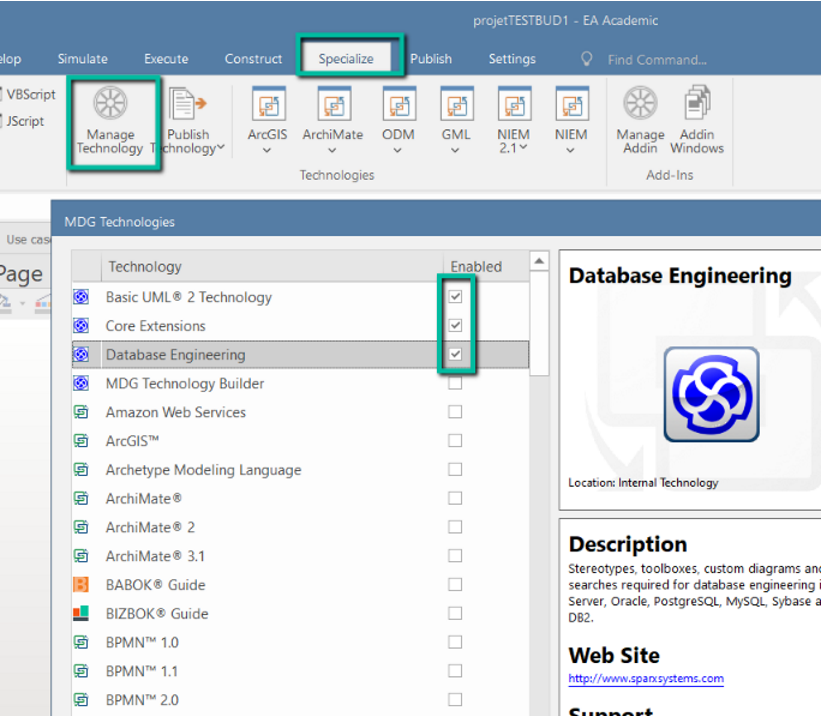

#### Customisation par l'onglet Start 

Dans le sous-menu Perspective, effectuez ces réglages afin de limiter les différentes perspectives disponibles 

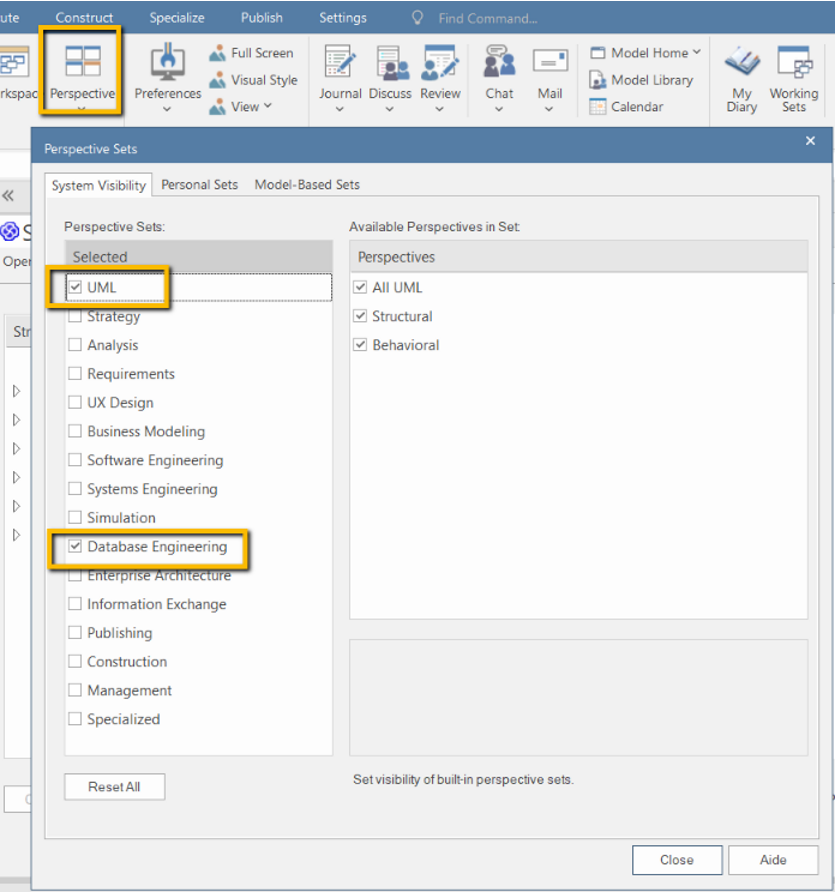

Le sous-menu Design vous permet en tout temps d'afficher les fenêtre que vous désirez. (ou que vous aurez fermé par mégarde!)

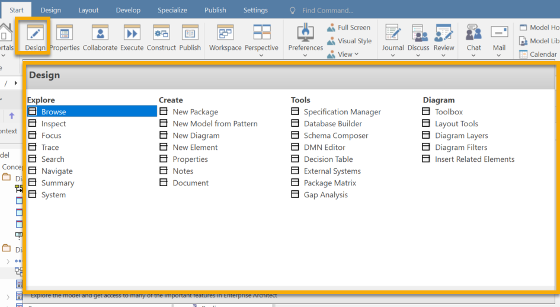

Le sous-menu Properties vous permet d'afficher les fenêtres de propriétés lors de l'édition d'un éléments.
Sélectionnez un des éléments des 3 premièrs catégories :

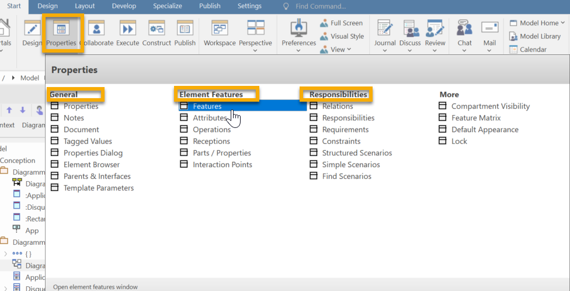

**-> Résultat**

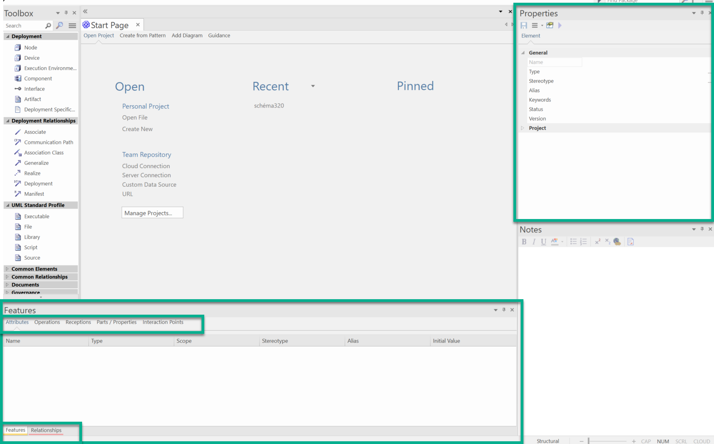

Dans le sous-menu Préférences, assurez-vous que Show Diagram Toolbar soit sélectionné

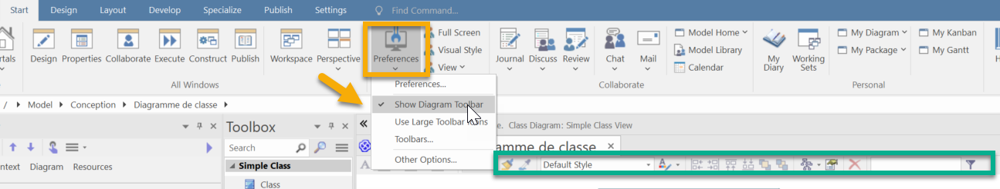

Finalement vous souvegardez votre espace de travail utilisant le sous-menu Workspace.

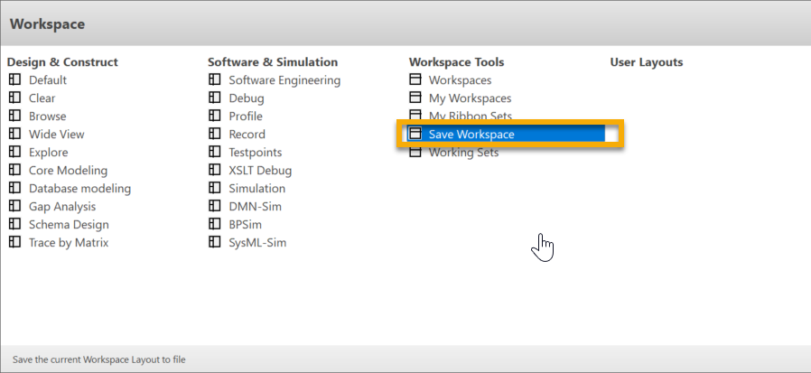

Vous sélectionnez votre espace de travail de la manière suivante:

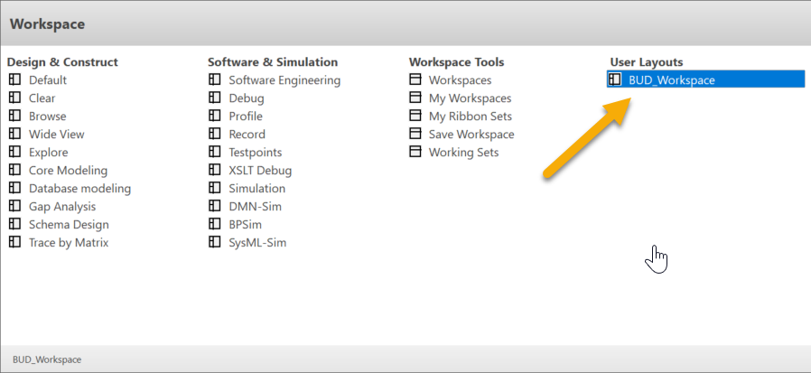

### Premier projet et organisation des répertoires

- Création d'un nouveau projet

    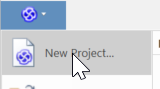

- Création des répertoires Analyse - Conception - Implementation avec des packages

    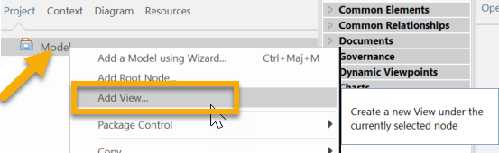
    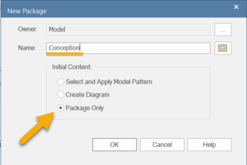

- Résultat
 
    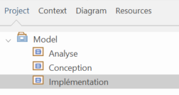

- Créez ensuite des sous-répertoires pour les différents diagrammes, en utilisant la fonction contextuelle `add a Package`. Résultat :
  
    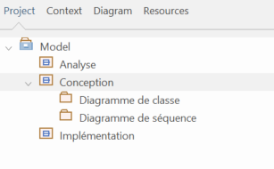
  
Votre projet est prêt pour la création des différents diagrammes.

## Diagramme de classes

Le diagramme de classe est utilisé pour représenter les classes et les interfaces.

Ce diagramme est statique, il ne traite pas des aspects temporels et dynamiques. Il ne représentent donc pas les objets qui seront instantiés lors de l'execution du programme.

Il est très utile au moment de la conception pour formaliser le choix des classes effectué, leur responsabilités, ainsi que les relations entre elles.
Lors de la maintenance d'une application, il permet rapidement de comprendre l'organisation et les interactions entre classes.

### Schéma d'une classe
Une classe est représentée par une rectangle séparé en trois parties.

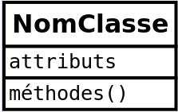

### Relation entre classes

Voici un rappel des différentes relations selon la norme UML

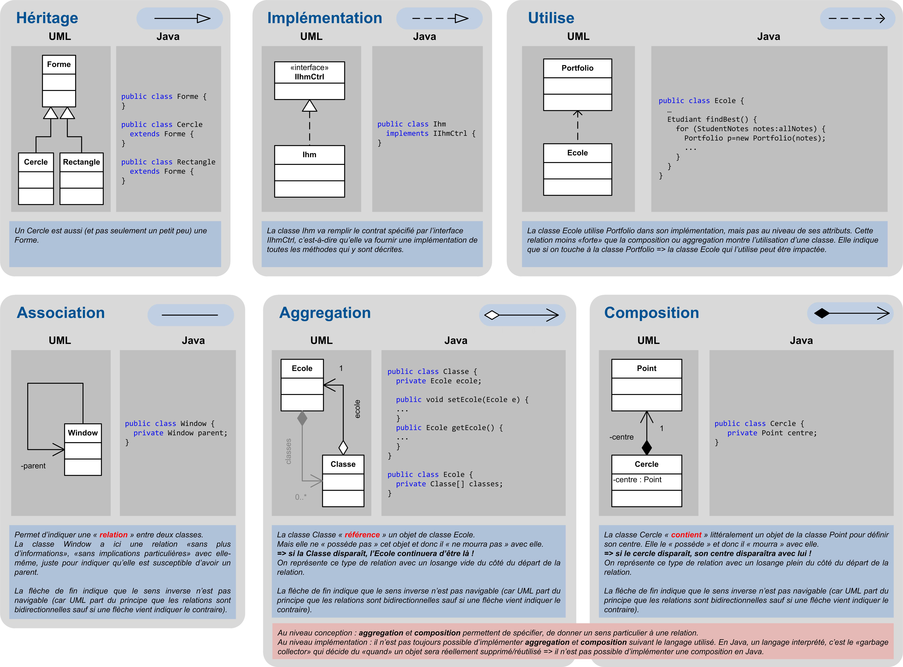

Attention, ce n'est pas parce que la composition n'est pas parfaitement réalisable en java qu'il ne faut pas l'utiliser dans les diagrammes UML. 
UML donne les intentions de développement et il est pertinent d'utiliser la composition lorsqu'une classe n'a pas de sens en dehors de son conteneur.

### Diagramme de classes avec EA

- Ajoutez un diagramme à l'aide du menu contextuel, sous le répertoire choisi

    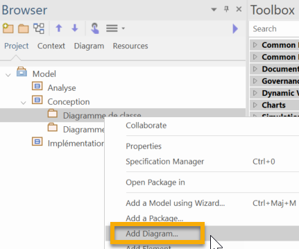

- Sélectionnez le diagramme à créer

    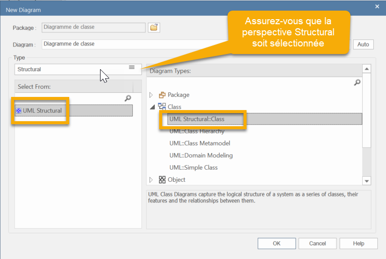

- Observez et utilisez les outils de l'interface

    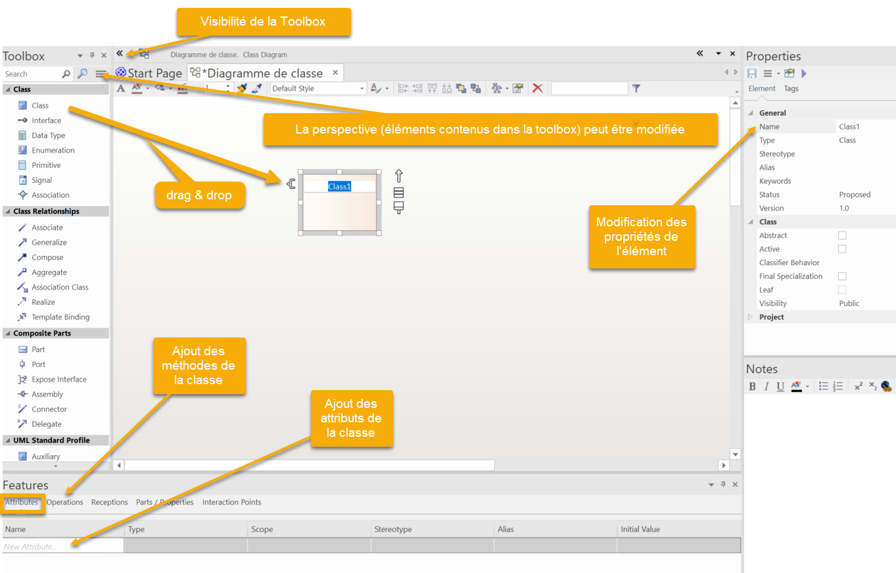

- Ajoutez une association en utilisant la flèche contextuelle
  
  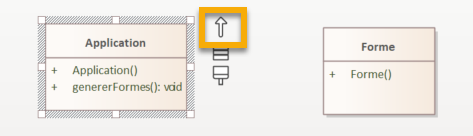

  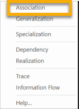
  
   Inidquer la direction `Source->Destination`, ce qui ajoutera la flèche.

   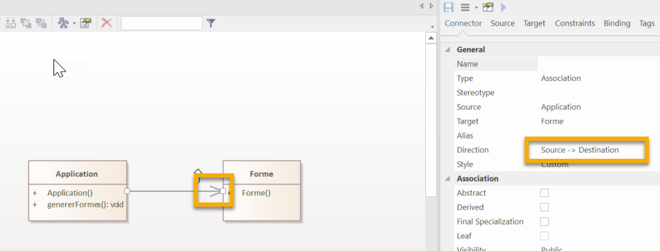

- Ensuite indiquez le types d'aggrégation dans le menu Source, afin d'ajouter le losange

    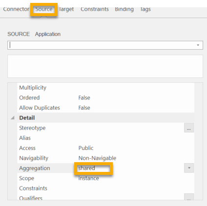

- Ensuite indiquez, dans le menu Target, la multipicité et la référence pour la cible.

    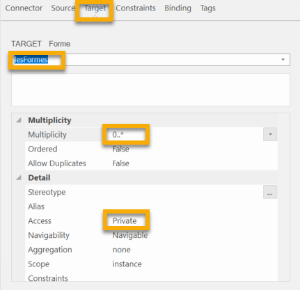

- Résultat

    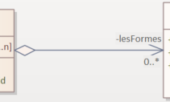

- Voici encore quelques informations :

    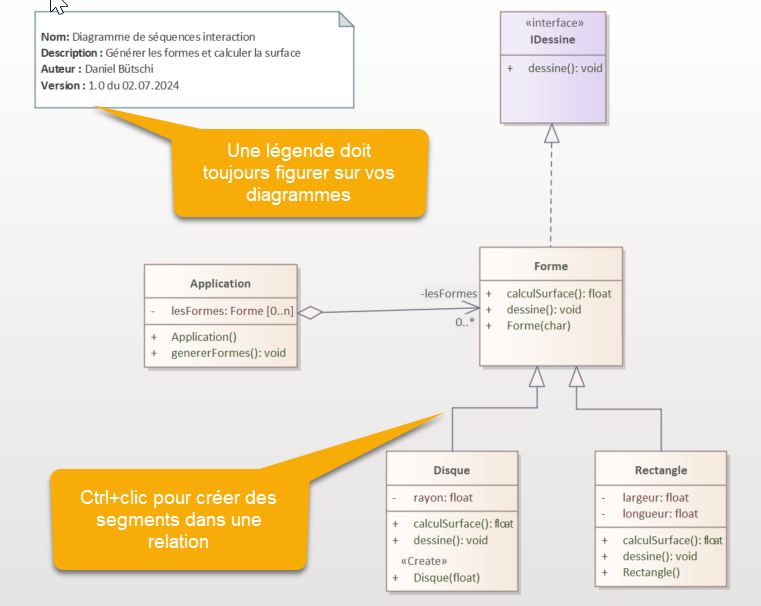

- Le menu LineStyle vous aider à mettre en forme vos relations

    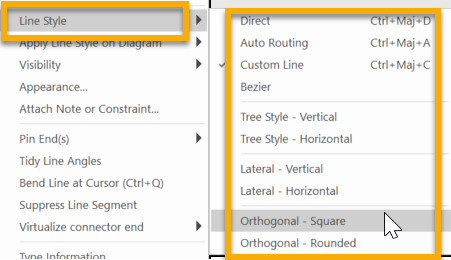

## Couleurs pour le modèle MVC

Voici les couleurs de classe à utiliser pour le modèle MVC

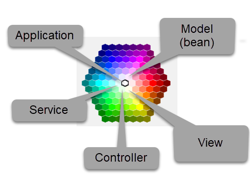

## Diagramme de séquence intercation

Le diagramme de séquence permet de montrer les interactions `d'objets` dans le cadre d'un scénario d'un diagramme des cas d'utilisation.

L'acteur principal est représenté à gauche et les acteurs secondaires à droite. Ces acteurs possèdent une ligne de vie qui permet d'enchaîner les actions dans le temps. Les périodes d'activité des objets sont représentées pas des rectangles.

### Diagramme de séquence avec EA

- Ajoutez un diagramme à l'aide du menu contextuel, sous le répertoire choisi

    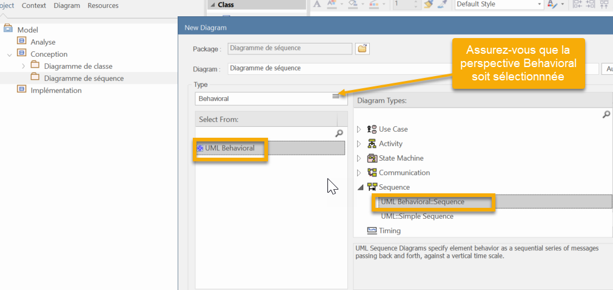

- Instantiez les objets avec du drag & drop depuis le diagramme du classe. Sélectionnez `Drop as Lifeline`.
  
    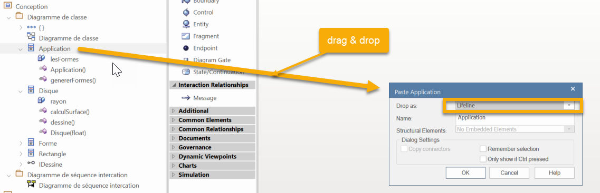

- Renseignez le nom de l'objet dans les propriétés
  
    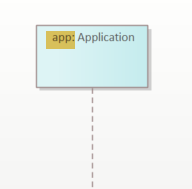

- Insérez un objet de type Forme et instantiez-le depuis l'objet app. Pour cela il est nécessaire de créer une relation (Message)  et de préciser le Lifecycle à `New`, afin que le bloc qui représente l'instance de classe soit à la hauteur de la relation.

    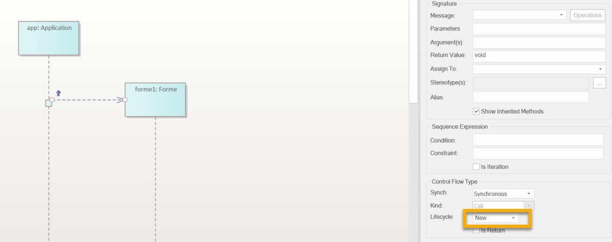

- Insérez ensuite un `Fragment` de type Alt (condition) afin d'effectuer un controle sur la valeur de la référence forme1.

    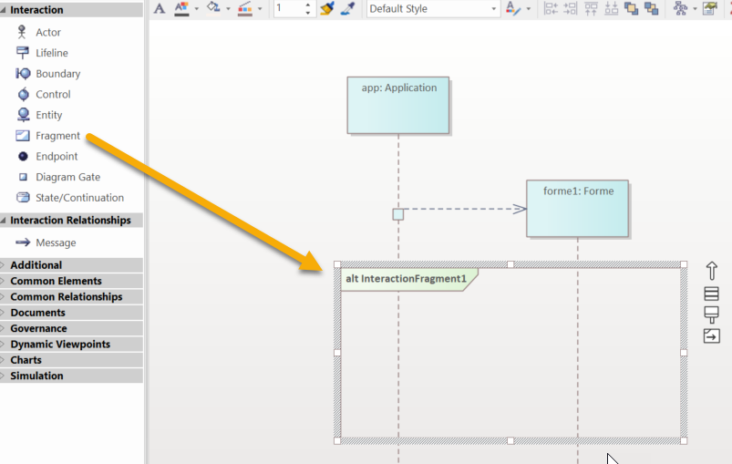

- Un double clic sur le fragment permet d'insérer un nom et différentes valeurs de condition.

    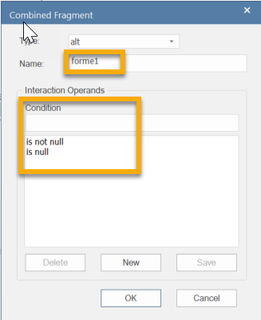

- Voici la condition complétée avec un appel à la méthode calculSurface de la forme1. Cette appel est synchrone et demande un message de retour (le résulat du calcul). Il est représenté par une flèche pointillée.

    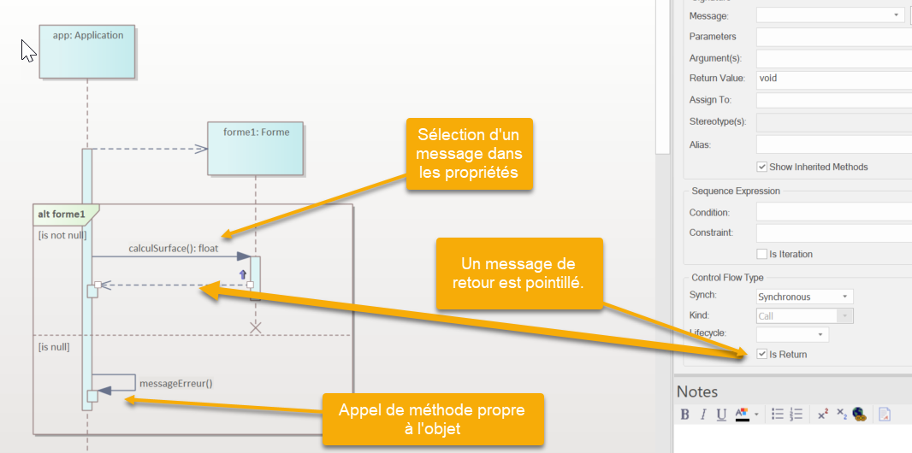

