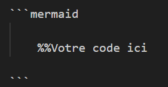
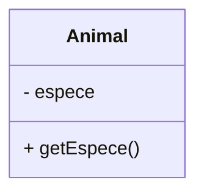
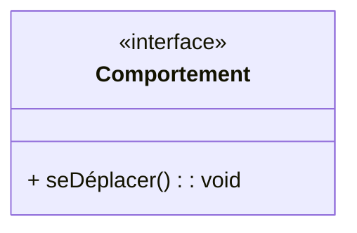
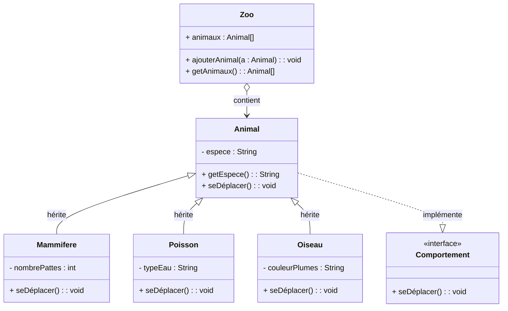
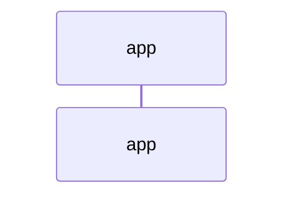
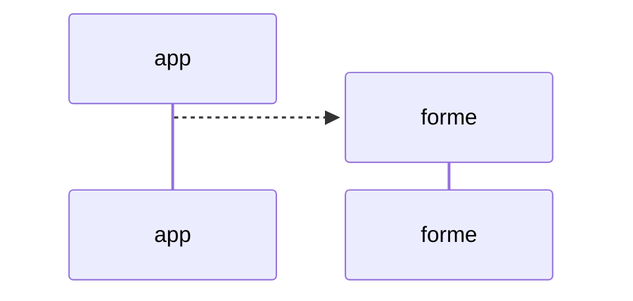
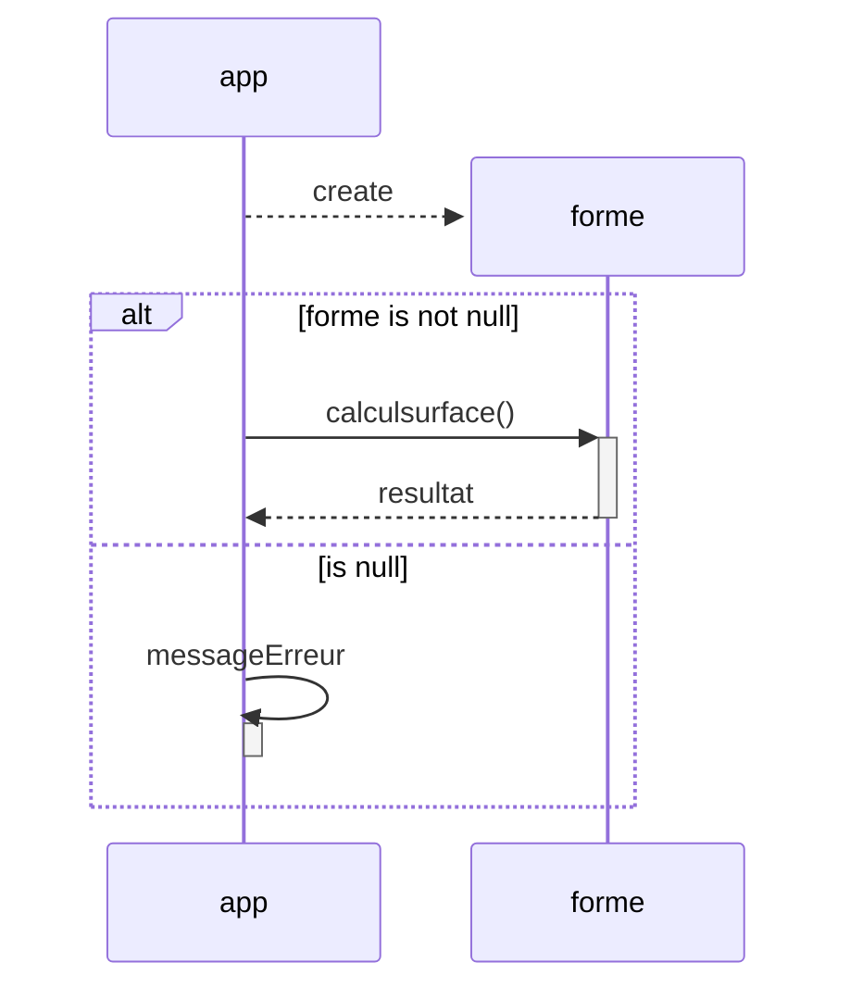

# Tutorial Mermaid

## Introduction
Mermaid est un langage de balisage qui vous permet de générer des diagrammes et des visualisations dynamiques à partir de texte. C'est un outil puissant pour créer des diagrammes de classe, des diagrammes de séquence, des organigrammes, et bien plus encore. Dans ce tutoriel, nous allons apprendre uniquement à créer un diagramme de classe simple avec Mermaid.

## Prérequis

Nous allons intégrer un diagramme de classe Mermaid dans un fichier Markdown. Il est nécessaire d'installer une extension sur Visual Studio Code pour visualiser les diagrammes Mermaid dans les fichier Markdown.

Voici une extension courrante: 
- Markdown Preview Mermaid Support

## Syntax

### Définir du code Mermaid
Pour utiliser Mermaid dans un document Markdown, il suffit de délimiter votre diagramme avec ces blocs de code:

## Diagramme de classe

### Déclarer un diagramme de classe avec une classe

    %%Voici comment déclarer un diagramme de classe avec une classe

    classDiagram  
    class Animal { 
       - espece      
       + getEspece()  
    }

### Déclarer une interface

    class Comportement {
        <<interface>>
        + seDéplacer() : void
    }

    

### Déclarer des relations entre classes

Voici les relations supportées en Markdown
| Type  | Description   |
|-------|---------------|
| `<\|--` | Héritage   |
| `*\-->`  | Composition   |
| `o\-->`  | Aggregation   |
| `--\>`  | Association   |
| `..\>`  | Dependence    |
| `..\|>` | Implémentation   |
| `--`   | Lien  |
| `..`   | Lien (Pointillé) |

#### Aggregation
    Zoo o--> Animal : contient

#### Héritage
    Animal <|-- Mammifere : hérite

#### Implémentation
    Animal ..|> Comportement : implémente

### Exemple

## Diagramme de séquence

### Déclarer un diagramme de séquence avec une ligne de vie d'un objet

    sequenceDiagram
        participant app

### Instantier un objet

    sequenceDiagram
        participant app
        create participant forme
        app-->>forme: 

### Créer une condition et des messages

Les mots clés alt/else/end permettent d'insérer un bloc de condition 

il est nécessaire d'ajouter le + et - à la suite de la flèche afin de rendre active la ligne de vie, ou d'utiliser le mot clé activate et deactivate.

    sequenceDiagram
        participant app
        create participant forme
        app-->>forme: create 

        %% condition avec alt
        alt forme is not null   
            app->>+forme: calculsurface()
            forme-->>-app: resultat
        else is null
            app->>+app: messageErreur
            activate app      
            deactivate app
        end   

## Type de messages

|`Type`	|`Description`|
|---------------------------------------|--------------------------------|
|->>	| ligne avec flèche|
|->>+| ligne avec flèche et activation de la ligne de vie|
|->>- |ligne avec flèche et désactivation de la ligne de vie|
|-->>	| pointillé avec flèche|
|-->>+| pointillé avec flèche et activation de la ligne de vie|
|-->>-| pointillé avec flèche et désactivation de la ligne de vie|

# Ressources

Vous trouverez toutes autres informations utiles dans ces ressources:

https://mermaid.js.org/syntax/classDiagram.html

https://mermaid.js.org/syntax/sequenceDiagram.html

