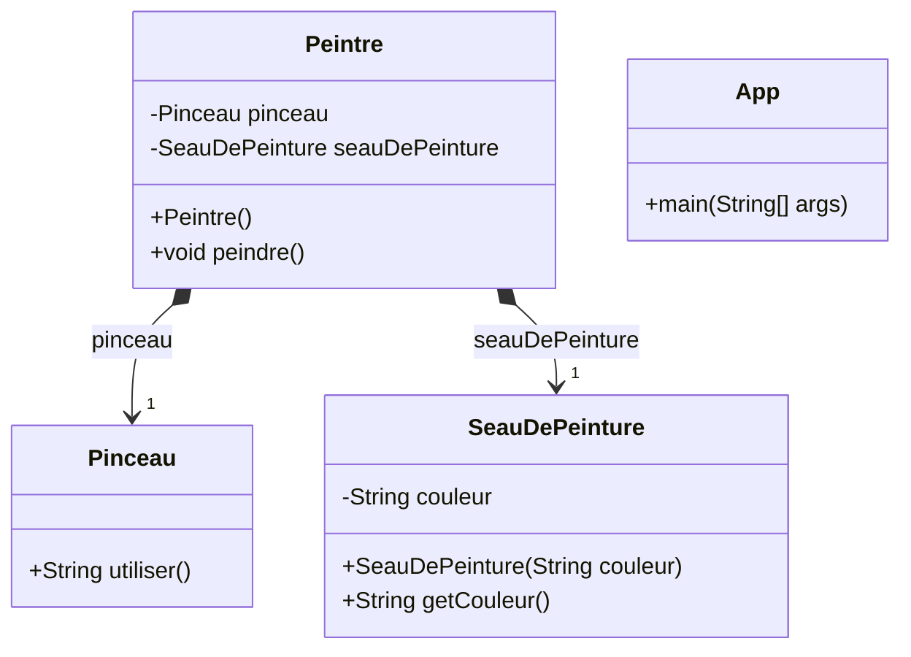
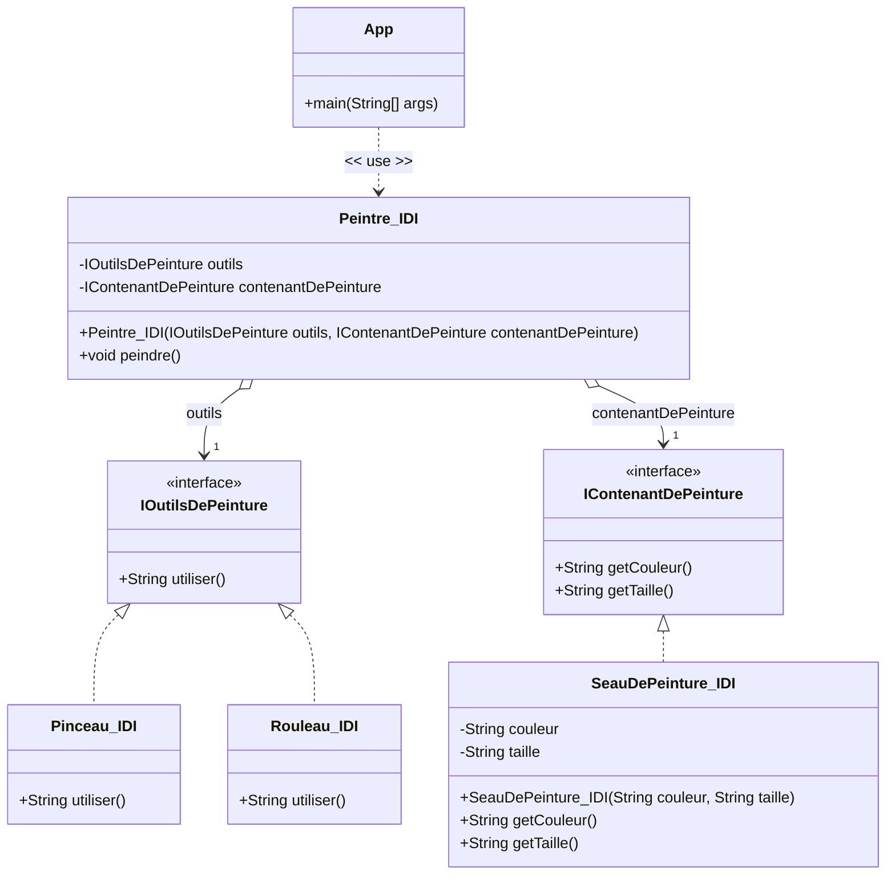

# L'injection de dépendances

L'injection de dépendances est aussi appelée **inversion de contrôle**.

C'est une technique dans laquelle un objet reçoit d'autres objets dont il dépend, au lieu de créer les objets dont il a besoin. 

C'est une notion que vous avez déjà rencontré au cours de ce module, mais nous allons l'aborder en détail.

## Dépendance classique : un objet crée les objets dont il a besoin

Pour commencer voici un scénario qui illustre une dépendance:

Imaginons que vous souhaitiez faire peindre votre salon par un peintre professionnel. Pour s’acquitter de sa tâche ce dernier va probablement venir avec ses propres outils, par exemple un simple pinceau et un seau de peinture.

```java

public class Pinceau {

    public String utiliser() {
       return "Utilisation du pinceau";
    }
}

public class SeauDePeinture {

    private String couleur;

    public SeauDePeinture(String couleur) {
        this.couleur = couleur;
    }

    public String getCouleur() {
        return couleur;
    }
}

public class Peintre {

    private Pinceau pinceau;
    private SeauDePeinture seauDePeinture;

    public Peintre() {
        //la classe instantie elle-même les dépendances dont elle a besoin
        this.pinceau = new Pinceau();
        this.seauDePeinture = new SeauDePeinture("Blanc satiné");
    }

    public void peindre() {
        System.out.println(pinceau.utiliser() + " avec " + seauDePeinture.getCouleur());
    }
}

public class App {

    public static void main(String[] args) throws Exception {
        Peintre peintre = new Peintre();
        peintre.peindre();
    }
}
```

**Dans ce cas, pinceau et seauDePeinture sont directement instantiés par peintre. Le coulpage est donc fort.**

Voici le diagramme de classe correspondant:



## Méthodes d'injection de dépendances

Il existe plusieurs méthodes d'injection de dépendance :

- Injection par constructeur : les dépendances sont fournies via le constructeur de la classe.
- Injection par setter : les dépendances sont fournies via des méthodes setter.
- Injection par interface : les dépendances sont injectées via une interface spécifique.

### Exemple d'injection de dépendances par constructeur

Dans cette méthode, les dépendances sont passées au constructeur de la classe. Cela garantit que l'objet est correctement initialisé avec toutes ses dépendances dès sa création.

Les classes `Pinceau` et `SceauDePeinture` sont identiques à l'exemple précédent.

```java

//IDC pour Injection de Dépendences par Constructeur
public class Peintre_IDC {

    private Pinceau pinceau;
    private SeauDePeinture seauDePeinture;

    public Peintre_IDC(Pinceau pinceau, SeauDePeinture seauDePeinture) {
        this.pinceau = pinceau;
        this.seauDePeinture = seauDePeinture;
    }

    public void peindre() {
        System.out.println(pinceau.utiliser() + " avec " + seauDePeinture.getCouleur());
    }
}

public class App {
    public static void main(String[] args) {
        //injection de dépendances par constructeur
        //les dépendances sont créées en amont.
        Pinceau pinceau = new Pinceau();
        //les dépendances sont injectées dans le constructeur
        SeauDePeinture seauDePeinture = new SeauDePeinture("Blanc satiné");
        Peintre_IDC peintre_IDC = new Peintre_IDC(pinceau, seauDePeinture);
        peintre_IDC.peindre();
    }
}

```

### Exemple d'injection de dépendances par setter

Dans cette méthode, les dépendances sont définies via des méthodes setter après la création de l'objet.

```java
//IDS pour Injection de Dépendences par Setter
public class Peintre_IDS {
    private Pinceau pinceau;
    private SeauDePeinture seauDePeinture;

    public void setPinceau(Pinceau pinceau) {
        this.pinceau = pinceau;
    }

    public void setSeauDePeinture(SeauDePeinture seauDePeinture) {
        this.seauDePeinture = seauDePeinture;
    }

    public void peindre() {
        System.out.println(pinceau.utiliser() + " avec " + seauDePeinture.getCouleur());
    }
}

public class App {
    public static void main(String[] args) throws Exception {
         //injection de dépendances par setter
        Pinceau pinceau = new Pinceau();
         //les dépendances sont créées en amont.
        SeauDePeinture seauDePeinture = new SeauDePeinture("Blanc satiné");
        Peintre_IDS peintre_IDS = new Peintre_IDS();
        //les dépendances sont injectées par les setters
        peintre_IDS.setPinceau(pinceau);
        peintre_IDS.setSeauDePeinture(seauDePeinture);
        peintre_IDS.peindre();
    }
}

```

### Exemple d'injection de dépendances par interface

Dans cette méthode, une interface est utilisée pour fournir les dépendances. Cela permet une plus grande flexibilité et facilite les tests.

En premier lieu, voici la définition des interfaces IOutilsDePeinture et IContenantDePeinture, qui apportent un niveau d'abstraction supplémentaire.

```java

public interface IOutilsDePeinture {
    String utiliser();
}


public interface IContenantDePeinture {
    String getCouleur();
    String getTaille();
}

```

Ensuite la déclaration des classes qui implémentent ces interfaces

```java

//IDI pour Injection de Dépendences par Interfaces
public class Pinceau_IDI implements IOutilsDePeinture{

    @Override
    public String utiliser() {
        return "Utilisation du pinceau";
    }
}

// Et voici un nouvel outil, un rouleau de peinture
public class Rouleau_IDI implements IOutilsDePeinture {

    @Override
    public String utiliser() {
        return "Utilisation du rouleau";
    }
}

public class SeauDePeinture_IDI implements IContenantDePeinture{

    private String couleur;
    private String taille;

    public SeauDePeinture_IDI(String couleur, String taille) {
        this.couleur = couleur;
        this.taille = taille;
    }

    @Override
    public String getCouleur() {
        return couleur;
    }

    @Override
    public String getTaille() {
        return taille;
    }
}

``` 

Classe `Peintre` utilisant les objets qui implémentent les interfaces

```java

public class Peintre_IDI {

    //les références sur les dépendances possèdent le type des interfaces.
    private IOutilsDePeinture outils;
    private IContenantDePeinture contenantDePeinture;

    public Peintre_IDI(IOutilsDePeinture outils, IContenantDePeinture contenantDePeinture) {
            this.outils = outils;
            this.contenantDePeinture = contenantDePeinture;
        }

    public void peindre() {
        System.out.println(outils.utiliser() + " avec " + contenantDePeinture.getCouleur());
    }
}

```
Et finalement

```java
public class App {
    public static void main(String[] args) throws Exception {
        //Injection de dépendances avec les interfaces
        //les dépendances sont créées en amont, avec le type de l'interface.
        IOutilsDePeinture pinceau = new Rouleau_IDI();
        IContenantDePeinture seauDePeinture = new SeauDePeinture_IDI("Brun","XXL");
        //les dépendances sont injectées dans le constructeur par l'intermédiaire des interfaces
        Peintre_IDI peintre_IDI = new Peintre_IDI(pinceau, seauDePeinture);
        peintre_IDI.peindre();
    }
} 
```

Avec le diagramme de classe



## Avantages de l'injection de dépendances

- Faible couplage : Les classes sont moins dépendantes les unes des autres.
- Testabilité : Il est plus facile de tester les classes individuellement.
- Flexibilité et maintenabilité : Le code est plus modulaire et plus facile à maintenir.

L'utilisation de l'injection de dépendances avec interfaces permet d'appliquer les principes de polymorphisme, d'abstraction, de faible couplage et de réutilisabilité.

